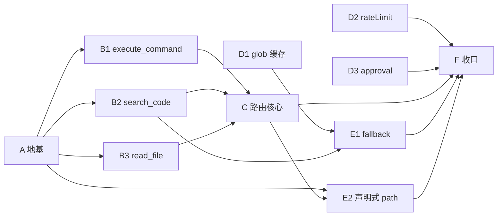

# 工程审查整改落地计划

> 来源：本轮四维审查（性能 / 代码健康度 / 可维护性 / 可扩展性）
> 范围：P0 全部、P1 全部、P2 结构性项
> 原则：每批一个可独立合并的 PR；A/B 行为不变，C 是唯一行为开关

## 1. 问题与批次映射

| 批次 | 覆盖问题 |
|---|---|
| A 地基 | P1-1 类型契约；P0-1 基础设施 |
| B 工具接地 | P0-1 工具侧；P1-2；P1-6（并入 B1） |
| C 路由核心 | P0-1 路由侧；P0-2；P2-1；P2-3 |
| D 独立优化 | P1-4；P1-5；P2-5 |
| E 回退与声明 | P1-3；P2-2 |
| F 收口 | P3-2；文档索引；全量验证 |

## 2. 依赖矩阵

| 工作项 | 依赖 | 独占/冲突文件 | 车道 |
|---|---|---|---|
| A1 execute 加可选 signal | 无 | tools/types.ts | A |
| A2 runWithDeadline 支持 signal | 无 | gateway/toolCallDeadline.ts；toolCallRoute.ts 两处调用 | A |
| A3 killProcessTree | 无 | 新增 servers/processTree.ts | A |
| A4 ToolConcurrencyGate | 无 | 新增 gateway/toolConcurrency.ts | A |
| B1 execute_command 接 signal + 定义缓存 | A1 A2 A3 | tools/executeCommandTool.ts；schemaValidation.ts | B |
| B2 search_code 接 signal + 游标消费 | A1 A2 A3 | tools/searchCodeTool.ts | B |
| B3 read_file 接 signal + 环形缓冲 | A1 A2 | tools/readFileLineStream.ts；readFileTool.ts | B |
| C 路由核心 | A B1 B2 B3 | gateway/toolCallRoute.ts；gateway/inFlightCalls.ts；gateway/toolRoutes.ts | C |
| D1 glob 缓存 | 无 | tools/globUtils.ts；tools/filesystemUtils.ts | D |
| D2 rateLimit | 无 | gateway/rateLimit.ts | D |
| D3 approval 惰性过期 | 无 | gateway/commandApproval.ts | D |
| E1 fallback 并发 + 流式 | B2 D1 | tools/searchCodeFallback.ts | E |
| E2 声明式 pathArguments | A C | gateway/pathArguments.ts；gateway/toolDefinitions.ts；tools/types.ts | E |
| F 收口 | 全部 | doc/；changelogs/ | F |

冲突规则：

- toolCallRoute.ts 只由 A（两行调用）与 C（大改）触碰，A 先合入。
- tools/types.ts 由 A1 引入、E2 追加，串行。
- filesystemUtils.ts 由 D1 改，E1 依赖其缓存 API，E1 排 D1 后。
- executeCommandTool.ts 由 B1 独占，D4 并入避免二次冲突。

## 3. 批次定义

### A 地基（行为零变化）

内容：A1-A4。工具尚未接 signal，路由传入永不 abort 的 signal；超时文案保持「is not a cancellation」，此时文案与行为一致。

验收：`pnpm --filter gateway-vscode run build` 通过；`run test` 全绿且超时相关测试零改动；新增 runWithDeadline 超时后 signal 收到 abort 的单测。

commit：

- refactor(tools): add optional abort signal to LocalTool.execute
- feat(gateway): add abortable deadline, process-tree kill helper, and concurrency gate

### B 工具接地（能力就绪，行为零变化）

内容：B1、B2、B3（三个 PR 可并行）。工具单测直接传 signal 验证取消；路由仍传永不 abort 的 signal。

验收：

- B1：长命令 abort 后进程组 300ms 内退出；Windows 走 taskkill /T /F；相同配置两次 getDefinition 返回同一对象。
- B2：maxResults 到达时 SIGKILL；游标消费无二次 slice。
- B3：10 万行 tail=1000 用环形缓冲，耗时基线下降；abort 后句柄关闭并 reject。

commit：

- fix(tools): abort execute_command process tree on timeout
- fix(tools): abort ripgrep and consume its output with a cursor
- fix(tools): honor abort in read_file and use an O(1) tail buffer

### C 路由核心（唯一行为开关）

内容：AbortController（超时 + 客户端断开）；ToolConcurrencyGate；finally 唯一 onToolCallEnd；callId 改 randomUUID 修同毫秒碰撞；统一 executeWithTelemetry；trace 参数裁剪；超时文案改「aborted」并同步测试。

验收：

- 假工具 signal.aborted 在超时后为 true。
- onToolCallEnd spy 恰好一次（成功/超时/断开）。
- gate max=1 时第二个请求排队而非并发。
- 超时后 inFlight 快照为空。
- 现有 gatewayTimeoutEnforcement 与 toolCallApproval 测试按新文案更新后全绿。

commit：

- fix(gateway): abort timed-out tool calls and finalize in-flight state in one place
- refactor(gateway): unify local and remote tool execution telemetry

回滚：revert 即回到「超时只放弃等待」；建议单独发布并在 changelog 标注行为变更。

### D 独立优化（可与 B 并行）

内容：D1、D2、D3。

验收：

- D1：同一 (pattern, caseSensitive) 二次 matchesPattern 复用编译结果；缓存有上限。
- D2：随机 key 压测后 hits 有界；窗口内命中用双指针原地压缩。
- D3：过期 grant 惰性删除，consume 返回 false。

commit：

- perf(tools): cache compiled glob patterns
- fix(gateway): bound rate limiter memory and remove per-call allocation
- perf(gateway): expire approval records lazily

### E 回退与声明（两 PR 并行）

内容：E1、E2。

验收：

- E1：fallback 并发度不超过 8，maxResults 早停，abort 可中断；输出与现有 golden 一致。
- E2：schema 声明 pathArguments 的第三方工具，file/dir 参数被 workspace 边界校验；硬编码清单删除。

commit：

- perf(tools): bound search_code fallback concurrency and stream files
- refactor(gateway): resolve declared path arguments instead of hard-coded names

### F 收口

内容：测试汇总、doc/README.md 索引、changelog、全量验证。

验收：`pnpm -r run build && pnpm -r run test`；`pnpm test:extension`；`pnpm lint`；索引包含本计划。

## 4. 依赖图

关键路径：A → B → C → F。

## 5. 执行编排

单人（约 12-14 工作日）：A(2) → B1(1) → B2(1) → B3(1) → C(2) → D1(1) → D2/D3(1) → E1(1.5) → E2(1) → F(1)

双人：

- 车道 1：A → C → F
- 车道 2：B1/B2/B3 → D1/D2/D3 → E1/E2
- 并行窗口：B 与 D 同时；E1 与 E2 同时。

三人：

- 车道 1：A → C → F
- 车道 2：B1 → B2 → E1
- 车道 3：B3 → D1/D2/D3 → E2
- 关键路径不变。

## 6. 风险登记

| 风险 | 影响 | 缓解 |
|---|---|---|
| C 批超时文案变更 | 客户端或测试断言文本 | 检查 bridge-browser 是否解析 timeout 文本；结构化字段不变 |
| Windows 无进程组语义 | 子进程残留 | 走 taskkill /T /F；CI 增加 Windows 单测 |
| fallback 流式改变输出 | 搜索回归 | 用现有 searchCodeTool 测试做 golden 对比 |
| LocalTool 签名波及 13 工具 | 编译失败 | A 用可选参数，B 只改 4 个；A 跑全量 build |
| callId 碰撞修复改快照 key | 恢复逻辑 | 仅内部 key，无外部契约；C 批测试覆盖 |

## 7. 验证基线

每批：`pnpm --filter gateway-vscode run build` + `pnpm --filter gateway-vscode run test`。

F 批追加：`pnpm -r run build`、`pnpm -r run test`、`pnpm test:extension`、`pnpm lint`。

## 8. 发版与 QA

- C 批涉及审批、结果传递与超时语义，属 VS Code 集成行为；可按 AGENTS.md 提醒 webcode-browser-qa 可用，需用户明确同意后在 qa:start 隔离工作区运行，不指向仓库工作树。
- 全部合入后走 release-package skill 发版；changelog 记录 C 批行为变更（超时从「放弃等待」变为「中止」）。
